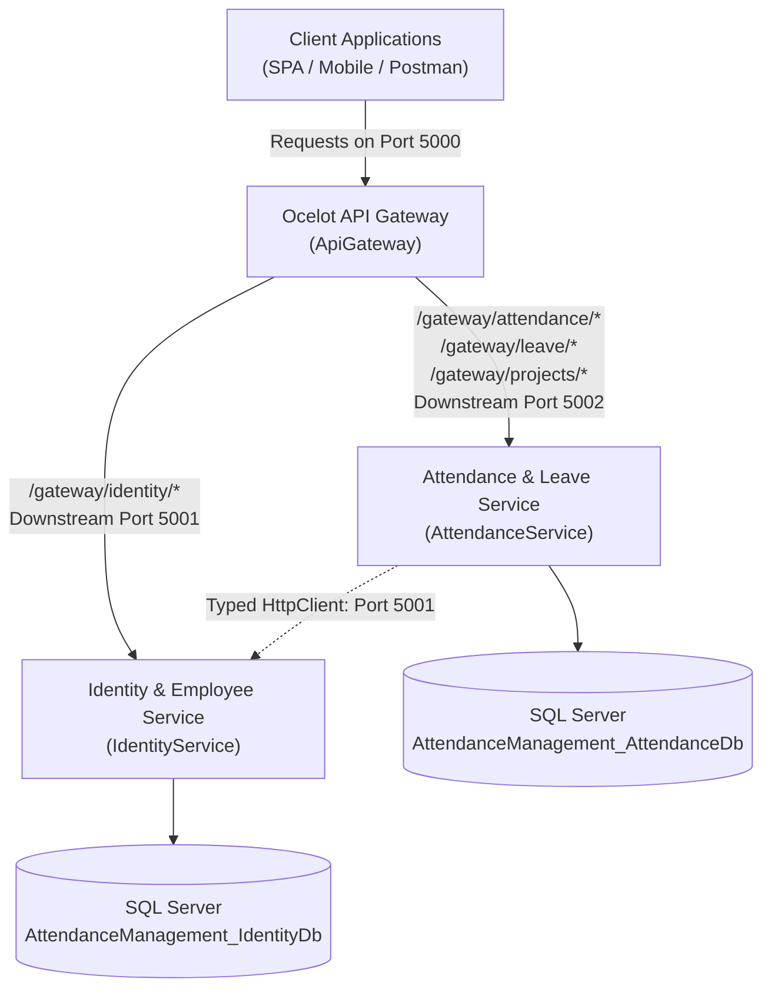

# Ocelot API Gateway Specification & Routing Table

## 1. Overview & Architectural Role

The **Attendance & Leave Management System** employs an **Ocelot API Gateway** as the unified reverse-proxy and ingress entry point for all client applications (web portals, mobile apps, third-party integrations).

- **Gateway Host**: `http://localhost:5000`
- **Identity & Employee Service (Downstream)**: `http://localhost:5001`
- **Attendance & Leave Service (Downstream)**: `http://localhost:5002`



---

## 2. Gateway Upstream vs. Downstream Routing Table

All external clients communicate through the Gateway using the `/gateway/*` URL prefixes.

### 2.1 Swagger Documentation Endpoints (Public)

| Upstream Path (Port 5000) | Downstream Service | Downstream Path | HTTP Methods | Priority | Authentication |
| :--- | :--- | :--- | :--- | :---: | :--- |
| `/gateway/swagger/identity/v1/swagger.json` | Identity (:5001) | `/swagger/v1/swagger.json` | `GET` | 2 | None (Public) |
| `/gateway/swagger/attendance/v1/swagger.json` | Attendance (:5002) | `/swagger/v1/swagger.json` | `GET` | 2 | None (Public) |

### 2.2 Identity & Employee Service Routes (`Downstream: http://localhost:5001`)

| Upstream Path (Port 5000) | Downstream Path (Port 5001) | HTTP Methods | Priority | Ingress Authentication | Downstream Authorization | Description |
| :--- | :--- | :--- | :---: | :--- | :--- | :--- |
| `/gateway/identity/auth/login` | `/api/v1/auth/login` | `POST` | 2 | None (Public) | `AllowAnonymous` | Employee login, issues access token & refresh token |
| `/gateway/identity/auth/refresh-token` | `/api/v1/auth/refresh-token` | `POST` | 2 | None (Public) | `AllowAnonymous` | Refresh expired access token |
| `/gateway/identity/auth/{everything}` | `/api/v1/auth/{everything}` | `GET, POST, PUT, DELETE` | 1 | `GatewayBearer` | `Authorize` / `Roles` | User registration (Admin), token revocation (logout) |
| `/gateway/identity/employees` | `/api/v1/employees` | `GET, POST` | Default | `GatewayBearer` | `Administrator,Manager` | Paginated employee list query |
| `/gateway/identity/employees/{everything}` | `/api/v1/employees/{everything}` | `GET, POST, PUT, DELETE, PATCH` | Default | `GatewayBearer` | `Authorize` / `Roles` | Employee profile, grade assignment, manager assignment, hierarchy, deactivation |

### 2.3 Attendance & Leave Service Routes (`Downstream: http://localhost:5002`)

| Upstream Path (Port 5000) | Downstream Path (Port 5002) | HTTP Methods | Ingress Authentication | Downstream Authorization | Description |
| :--- | :--- | :--- | :--- | :--- | :--- |
| `/gateway/attendance` | `/api/v1/attendance` | `GET, POST` | `GatewayBearer` | `Authorize` | Log daily attendance (auto-approval if assigned) |
| `/gateway/attendance/{everything}` | `/api/v1/attendance/{everything}` | `GET, POST, PUT, DELETE, PATCH` | `GatewayBearer` | `Authorize` / `Roles` | Approval, rejection, cancellation, employee history, daily/weekly/monthly reports |
| `/gateway/leave` | `/api/v1/leave` | `GET, POST` | `GatewayBearer` | `Authorize` | Apply for leave against append-only ledger |
| `/gateway/leave/{everything}` | `/api/v1/leave/{everything}` | `GET, POST, PUT, DELETE, PATCH` | `GatewayBearer` | `Authorize` / `Roles` | Review leave, cancel, update, employee history, real-time balance lookup |
| `/gateway/leavecredit/{everything}` | `/api/v1/leavecredit/{everything}` | `GET, POST` | `GatewayBearer` | `Administrator` | Monthly grade accrual batch processing, manual ledger adjustments |
| `/gateway/projects` | `/api/v1/projects` | `GET, POST` | `GatewayBearer` | `Authorize` / `Roles` | Project creation, project listing |
| `/gateway/projects/{everything}` | `/api/v1/projects/{everything}` | `GET, POST, PUT, DELETE` | `GatewayBearer` | `Authorize` / `Roles` | Project update, deactivation, employee assignment, assignment history, assignment deactivation |

---

## 3. Cross-Cutting Capabilities

### 3.1 Zero-Trust Defense-in-Depth Authentication Model
- **Ingress Gateway Validation**: The Gateway validates the JWT token's cryptographic signature, issuer, audience, and expiration date using the `GatewayBearer` scheme before proxying requests to protected routes. Malformed, expired, or unsigned tokens are rejected at ingress with HTTP 401 Unauthorized.
- **Token Forwarding**: When proxying authenticated requests, Ocelot forwards the raw `Authorization: Bearer <token>` header downstream to the target microservice.
- **Independent Downstream Validation**: Both downstream microservices run their own independent JWT Bearer authentication handlers that re-validate the token's cryptographic signature and evaluate fine-grained role claims (`Administrator`, `Manager`, `ActiveEmployeeOnly`).
- **Zero-Bypass Guarantee**: Even if an unauthorized client directly targets downstream port 5001 or 5002, requests are rejected by the downstream service's own independent authentication pipeline.

### 3.2 Unified Swagger UI Exploration
- A single, aggregated Swagger UI is hosted directly at:
  ```
  http://localhost:5000/swagger
  ```
- The UI provides a dropdown selector to inspect both services:
  1. **Identity & Employee API v1 (Gateway)**: Loads `/gateway/swagger/identity/v1/swagger.json`
  2. **Attendance & Leave API v1 (Gateway)**: Loads `/gateway/swagger/attendance/v1/swagger.json`
- Both business microservices still retain their own independent Swagger interfaces at root `http://localhost:5001/` and `http://localhost:5002/`.

### 3.3 Distributed Tracing (`X-Correlation-ID`)
- The Gateway checks incoming HTTP requests for an `X-Correlation-ID` header.
- If absent, the Gateway generates a new GUID and injects it into both the incoming request headers and the outgoing response headers.
- When forwarding downstream, Ocelot propagates the `X-Correlation-ID` header to Identity and Attendance services.
- Each service's Serilog logger enriches all log entries with `[CorrelationId]`, enabling complete distributed request tracing across the gateway and both microservices.

### 3.4 Gateway Health Probe
- An instant, zero-overhead health check endpoint is hosted directly on the Gateway pipeline:
  ```http
  GET http://localhost:5000/health
  ```
  **Response**:
  ```json
  {
    "status": "Healthy",
    "gateway": "ApiGateway",
    "port": 5000
  }
  ```

### 3.5 Cross-Origin Resource Sharing (CORS)
- Configured with `AllowAllClients` policy (`AllowAnyOrigin`, `AllowAnyMethod`, `AllowAnyHeader`) to permit seamless browser and mobile client integration during development and staging.

---

## 4. Local Development Port Allocations

Each project is configured with a dedicated [`Properties/launchSettings.json`](file:///home/dev/dev/work/AttendancePro/src/ApiGateway/Properties/launchSettings.json) to eliminate local port conflicts during simultaneous execution:

| Service Project | Launch Profile URL | Target Database |
| :--- | :--- | :--- |
| **`ApiGateway`** | `http://localhost:5000` | *N/A (Stateless)* |
| **`IdentityService`** | `http://localhost:5001` | `AttendanceManagement_IdentityDb` |
| **`AttendanceService`** | `http://localhost:5002` | `AttendanceManagement_AttendanceDb` |
